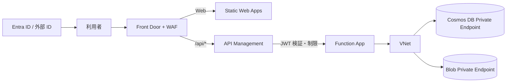

# SaaS 化に向けたインフラ構成の提言

## 対象と前提

本書は `infra/main.bicep` と Static Web Apps / Functions の現行設定を確認し、社内 PoC からインターネット向け SaaS に発展させる場合の構成を整理したものです。ここでは既存の構成を直ちに変更せず、要件と優先度に応じた追加案を示します。

## 現状の評価

現状は PoC として、データ層に一定のネットワーク・認証制御があります。

- Cosmos DB とアプリケーションデータ用 Blob Storage は Public Network Access が無効で、Private Endpoint 経由です。
- 両サービスの共有キー認証を無効にし、Functions からマネージド ID で接続します。
- Function App は Flex Consumption、VNet 統合、HTTPS 強制、TLS 1.2 です。
- Cosmos DB は Free Tier、単一リージョン、共有スループット 400 RU/s の設定です。

SaaS 化に向けて最初に解消すべき大きな課題は、エンドユーザーの認証・認可とテナント分離です。現在の `src/frontend/staticwebapp.config.json` にルート制限はなく、API ハンドラーは `authLevel: 'anonymous'` です。Cosmos DB の一覧処理も全件検索になっています。SWA の画面やルートを保護するだけでなく、API 側でトークンを検証し、各リクエストでテナントと操作権限を確認する必要があります。

また、Function App 用のホスト／デプロイ用 Storage Account は共有キー認証が無効ですが、Bicep 上で Public Network Access は無効化されていません。Flex Consumption の要件を確認し、Blob、Queue、Table など実際に使うサービスごとに必要な Private Endpoint、Private DNS、アクセス制御を検討します。

## SaaS の最低限として整える項目

### 1. 認証と認可

- Entra ID または採用する外部 ID プロバイダーで利用者を認証し、許可する組織・テナントを限定します。
- Static Web Apps の `staticwebapp.config.json` に認証必須のルートを定義します。
- API 側でもトークンを検証し、ユーザー、ロール、テナントに応じて操作を認可します。フロントエンドの制御、CORS、ルート設定だけに依存しません。
- 管理者操作、データ削除、手動ジョブ実行は通常の利用者権限から分離します。

### 2. テナント分離と API の濫用対策

- Cosmos DB のパーティションキーをテナント単位のアクセス特性に合うよう再設計します。現在の `/id` のままではテナント単位の分離・問い合わせに不向きな場合があります。
- テナント ID は検証済みのトークンから決定し、クライアントが送る値をそのまま信用しません。全ての読み書き・削除クエリでテナント条件を強制します。
- 全件取得を避け、ページング、ページサイズ上限、クエリ条件、要求本文とアップロードのサイズ上限を設けます。
- API または APIM で利用者／テナント単位のレート制限・クォータを設定し、コスト増加や大量リクエストを抑制します。
- Blob の保存先もテナント単位で名前空間を分け、認可済みの利用者だけが該当データにアクセスできるようにします。

### 3. 権限とネットワーク

- マネージド ID に付与するデータプレーンロールを必要最小限にし、可能な範囲でアカウント全体からコンテナー／データベース単位へ絞ります。
- API と定期実行ワーカーを分離する場合は、Function App とマネージド ID を分け、役割に応じて異なる権限を付与します。
- Function App 用 Storage の通信要件を調査し、利用するストレージサブリソース（Blob／Queue／Table 等）だけに Private Endpoint を追加します。パブリックアクセスを止める前に、ホスト処理、デプロイ、監視が正常に接続できることを確認します。
- Storage と Cosmos DB の Private DNS、VNet 統合、名前解決、診断ログの送信経路を合わせて確認します。

### 4. 監視と復旧

- アプリケーション監査ログ、認証・認可失敗、API エラー、レート制限、Functions の失敗を記録し、対応が必要な事象にアラートを設定します。
- Cosmos DB のバックアップとポイントインタイムリストア、Blob のバージョン管理・論理削除・ライフサイクルを、保持期間と復旧目標に合わせて選びます。
- バックアップの有効化だけでなく、復元手順と復元後の接続切り替えを定期的に確認します。
- 環境ごとのコスト予算と利用量アラートを設定します。

## Front Door、APIM、Azure Firewall の使い分け

### Front Door + WAF

インターネット向け Web アプリのエッジで HTTP 攻撃への防御、ボット対策、TLS 終端、ルーティングを行います。グローバル配信、独自ドメイン、複数リージョンへの切り替えや、WAF ポリシーが必要になった段階で検討します。SWA 自体にもグローバル配信機能があるため、単一リージョンの PoC では必須ではありません。

### API Management

複数の API クライアント、外部公開 API、API バージョン管理、クォータ、集中した JWT 検証や分析が必要な場合に導入します。単一のフロントエンド向け API であれば、まずアプリケーションでの認証・認可と濫用対策を整え、運用上必要になった段階で導入できます。

### Azure Firewall

VNet の送信先制限、FQDN ベースの通信制御、複数 VNet にまたがる集中検査、脅威検知などが必要な場合に使用します。Web アプリの HTTP 攻撃対策を担う WAF の代わりではありません。閉域のデータ層に Private Endpoint があるだけで Firewall が必須になるわけではありません。

## 強化構成の例

Front Door で Web と API の入口を振り分け、APIM で API のトークン検証・制限を行い、Function App は APIM 経由だけで到達可能にします。データアクセスは既存の VNet と Private Endpoint を継続利用します。

この構成では、SWA の BYOF API バックエンドを Function App に直接接続する現在の経路から変更が必要です。SWA API の制約上、ネットワーク分離された API バックエンドはサポートされていません。Front Door で `/` を SWA、`/api/*` を APIM にルーティングし、APIM から Function App に接続する案が候補です。採用時は、トークンの受け渡し、Function App への直接アクセス防止、APIM SKU のネットワーク機能とコストを設計時に確認します。

## スケーラビリティとデータベース選択

### Cosmos DB

Free Tier はアカウントあたり最大 1,000 RU/s、25 GB の無料枠です。現在の 400 RU/s、単一リージョン設定は小規模 PoC 向けであり、SaaS の可用性・容量要件を満たすとは限りません。本番化時は負荷とデータ量を計測して、必要なスループット、オートスケール、リージョン数、フェイルオーバー、バックアップ、復旧目標を決めます。

アイドル時間が長く予測しにくい負荷には Serverless が候補になりますが、利用した RU とストレージに応じて課金され、アカウントは単一リージョンです。予測可能な高負荷や複数リージョンの可用性が必要なら、プロビジョニング済みスループットとオートスケールを評価します。

### PostgreSQL

リレーショナルな整合性、複雑な結合、SQL ベースの分析や既存システムとの互換性が必要になった場合に追加します。Cosmos DB の単純な置き換え・追加として導入するのではなく、データモデルと要件に基づいて判断します。採用する場合は、Private Link／VNet 接続、認証、暗号化、バックアップ、HA、接続プーリング、テナント分離（必要なら Row-Level Security）を設計します。

## 推奨する導入順

1. 利用者認証、API 側の認可、テナント分離を設計・実装する。
2. API のページング、入力上限、レート制限と最小権限を整える。
3. Function 用 Storage のネットワーク公開範囲と必要な Private Endpoint を確認する。
4. 監査、アラート、バックアップ、復旧目標を整える。
5. 実測した負荷・可用性要件を基に Cosmos DB の容量・リージョン構成を決める。
6. 外部 API 管理やエッジ防御の要件が明確になった段階で APIM、Front Door + WAF を追加する。
7. 中央集約型の送信通信検査が必要な場合に Azure Firewall を、リレーショナル要件が生じた場合に PostgreSQL を検討する。

## 参考資料

- [Static Web Apps の API 概要と制約](https://learn.microsoft.com/en-us/azure/static-web-apps/apis-overview)
- [Static Web Apps の認証と認可](https://learn.microsoft.com/en-us/azure/static-web-apps/authentication-authorization)
- [Static Web Apps の構成とルート保護](https://learn.microsoft.com/en-us/azure/static-web-apps/configuration)
- [Azure Functions のネットワーク機能](https://learn.microsoft.com/en-us/azure/azure-functions/functions-networking-options)
- [Azure Storage の Private Endpoint](https://learn.microsoft.com/en-us/azure/storage/common/storage-private-endpoints)
- [Azure Front Door のセキュリティ](https://learn.microsoft.com/en-us/azure/frontdoor/secure-front-door)
- [API Management のポリシー](https://learn.microsoft.com/en-us/azure/api-management/api-management-policy-reference)
- [Azure Firewall、DDoS、WAF の使い分け](https://learn.microsoft.com/en-us/azure/networking/security/network-security)
- [Cosmos DB の制限と Free Tier](https://learn.microsoft.com/en-us/azure/cosmos-db/concepts-limits)
- [Cosmos DB Serverless](https://learn.microsoft.com/en-us/azure/cosmos-db/serverless)
- [Cosmos DB の連続バックアップと PITR](https://learn.microsoft.com/en-us/azure/cosmos-db/provision-account-continuous-backup)
